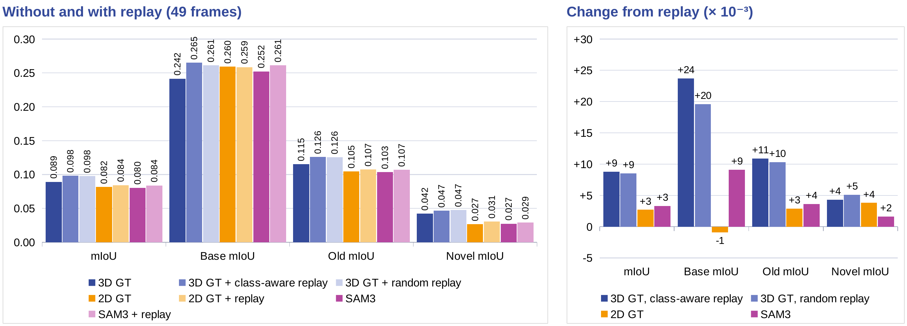
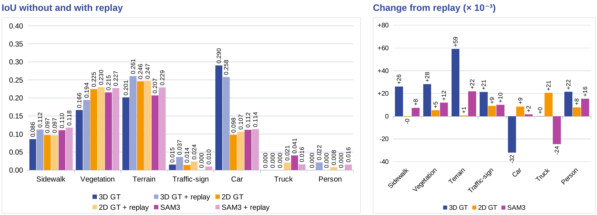
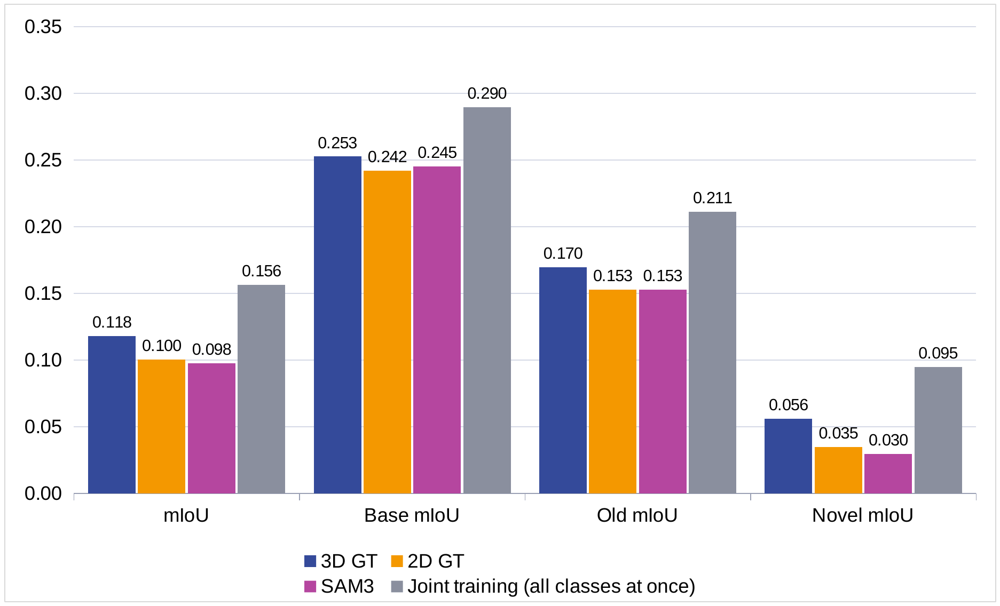
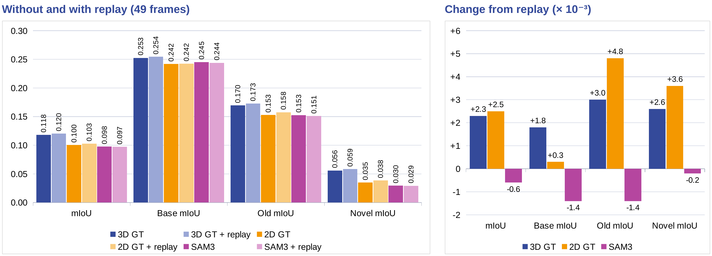
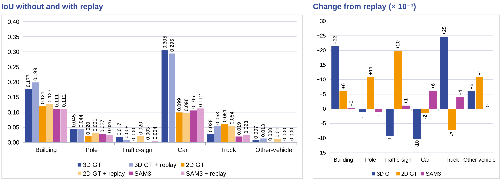

# Label-Free Class-Incremental 3D Semantic Scene Completion

Master's project at the University of Freiburg: a **5-step disjoint class-incremental learning** pipeline for
semantic scene completion on SemanticKITTI, built on top of [DISC](https://github.com/Enyu-Liu/DISC)
(Liu et al., *Disentangling Instance and Scene Contexts for 3D Semantic Scene Completion*, ICCV 2025).

The model is taught the 17 SemanticKITTI classes in five stages and never sees the earlier stages' labelled data again.
Forgetting is reduced with teacher pseudo-labels and a small replay buffer, and the new classes are learned from 3D ground
truth, from projected 2D ground truth, or from open-vocabulary [SAM 3](https://github.com/facebookresearch/sam3) masks.

**Slides:** [project presentation (PDF, 39 slides)](./docs/presentation.pdf), covering motivation, related work, method, results and conclusions.

### Key results

SemanticKITTI validation sequence 08, 5-step split, final step (all 17 classes):

- **Forgetting is the main problem.** mIoU falls from 0.2526 after step 0 to 0.0892 after step 4 with pseudo-label distillation alone.
  The four classes introduced last (bicycle, motorcycle, bicyclist, motorcyclist) stay below 0.02 IoU in every recipe.
- **A 49-frame replay buffer helps at every step.** With 3D labels it raises Old mIoU by 4.2 / 4.9 / 5.1 / 9.5 % (relative) at steps 1-4,
  and the final-step mIoU from 0.0892 to 0.0980. A random buffer of the same size is almost as good (0.0977).
- **3D labels beat 2D-only supervision for the new classes.** 2D ground truth and SAM 3 masks trail 3D ground truth with replay by about
  0.014-0.017 mIoU from step 2 on, and SAM 3 comes within about 0.003 of 2D ground truth.

**What "label-free" means here.** The new classes are learned from 3D labels, from 2D masks, or from SAM 3 text-prompted masks.
The SAM 3 recipe needs no annotation for the new classes at all. The 2D-GT recipe is a proxy for cheap 2D annotation (its masks are
projected from the 3D labels), and the 3D-GT recipe is the fully supervised reference, which also scores best.

**Limits.** Each result is one run (one seed) on one validation sequence. There is no joint-training reference for the 5-step split
(only for the 3-step split) and no comparison with published class-incremental methods. Checkpoints, masks, pseudo-labels and
datasets are not included, so the numbers cannot be reproduced from this repository alone.



## What this repository contains

**This repository contains only my additions, not the DISC code.** The DISC code has no license, so it is not
redistributed here. Instead, this repository holds the new files, plus patches against the upstream files I modified,
pinned to upstream commit [`00ecc7f`](https://github.com/Enyu-Liu/DISC/commit/00ecc7fc592e07558b9f5516b4c9fbada6892b4e).

| Path | What it is |
| ---- | ---------- |
| `tools/` | New scripts: pseudo-label dumping, replay-buffer selection and annotation, 2D GT and SAM 3 mask generation, 2D mask evaluation, class statistics, tau visualisation |
| `ssc_ia/models/losses/render_2d_loss.py` | The 2D render loss used for the 2D-GT and SAM 3 recipes |
| `configs/sam_classes_*.json` | SAM 3 text prompts per class and step (single-prompt and multi-prompt), in compact class ids |
| `patches/` | My changes to upstream files, one `.patch` per file (listed below) |
| `scripts/apply_to_upstream.sh` | Clones upstream at the pinned commit, copies the new files in and applies the patches |
| `docs/results/` | Result charts used in this README |

Patches (each is a diff against the upstream file):

| Patch | Change |
| ----- | ------ |
| `ssc_ia/data/datasets/semantic_kitti.py` | 5-step sequence split, pseudo-label and 2D-mask loading, replay buffers (`random` and `file`) |
| `ssc_ia/data/build.py` | Base / new / old / novel class groups, compact class space, pass pseudo and render settings through |
| `ssc_ia/engine/lit_module.py` | Training loop with the pseudo-label loss, the 2D render loss and replay-frame routing |
| `ssc_ia/models/segmentators/iascene.py` | Class-incremental class bookkeeping (seen / old / new classes) |
| `ssc_ia/models/decoders/decoder.py` | Single `ssc_logits` output instead of a list, upsample rule |
| `ssc_ia/models/losses/ssc_loss.py`, `ssc_ia/models/losses/__init__.py` | Class-incremental targets and class weights, safe handling of empty target groups, registration of the render loss |
| `ssc_ia/evaluation/ssc_metric.py` | Base / new / old / novel mIoU |
| `ssc_ia/utils/projection.py` | Projection / visualisation helpers that handle the class-incremental (compact) targets |
| `ssc_ia/utils/build.py` | Checkpointing: best and last checkpoint, early stopping disabled |
| `tools/train.py`, `tools/test.py` | Class-incremental training and evaluation entry points |
| `configs/*` | Config files for the 5-step runs (see the note on config state below) |

The patches also change some training settings relative to upstream DISC: the model config uses 2 instead of 3 layers in each
decoder stream and only the `sem_scal`, `geo_scal` and `ce_ssc` losses, the learning rate is 1e-4, and `config_sema.yaml` trains
for 15 epochs with the learning-rate drop at epoch 13. Results here are therefore not comparable with the numbers in the DISC paper.

## Getting started

```bash
git clone <this repository>
cd <this repository>
bash scripts/apply_to_upstream.sh DISC-dcil     # clones upstream DISC, adds the new files, applies the patches
cd DISC-dcil
export PYTHONPATH=$(pwd):$PYTHONPATH
```

Then follow the upstream instructions for the environment, the SemanticKITTI data
([Symphonies](https://github.com/hustvl/Symphonies) preparation guide) and the MaskDINO / Swin weights in `pretrain/`.
The commands for a full 5-step run are in [Running a step](#running-a-step).

## 🧩 The 5-step class-incremental setting

The original DISC trains on all semantic classes at once. This project asks a different question: **what happens when the
classes arrive in stages, and the model never sees the earlier stages' labelled data again?** The 17 SemanticKITTI
classes are introduced over 5 steps, and each step trains only on its own two sequences (*disjoint* scenario).
`other-ground` and `other-vehicle` are dropped entirely because they are near-zero IoU in every setting and have no usable
SAM 3 prompt.

| Step | Train sequences | Frames | New classes (SemanticKITTI id) |
| :--: | :-------------: | -----: | ------------------------------ |
| 0 | 01, 10 | 462  | road (9), sidewalk (11), vegetation (15), terrain (17) |
| 1 | 03, 04 | 216  | fence (14), trunk (16), pole (18) |
| 2 | 05, 09 | 872  | car (1), person (6), traffic-sign (19) |
| 3 | 06, 07 | 442  | truck (4), parking (10), building (13) |
| 4 | 00, 02 | 1842 | bicycle (2), motorcycle (3), bicyclist (7), motorcyclist (8) |

Sequence 08 is the validation set for every step. The sequence pairs were chosen from per-sequence class statistics
(`tools/compute_class_stats.py`); e.g. only sequences 00 and 02 contain meaningful bicyclist / motorcyclist data, so the
rarest classes come last. The split lives in `configs/datasets/semantic_kitti.yaml` (`continual_splits`) and in
`DISJOINT_SEQ` in `ssc_ia/data/datasets/semantic_kitti.py` (see `patches/`).

### Ingredients

At step *N* the model is initialised from the step *N-1* checkpoint, and three mechanisms fight forgetting and teach new classes:

- **Pseudo-label distillation (old classes).** A frozen teacher (the step *N-1* model) labels the current frames.
  Only voxels with confidence above `pseudo.tau` (0.8) are used, in an extra cross-entropy term weighted by `pseudo.lambda_old`.
  Pseudo-labels are dumped once to disk (`pseudo.mode: offline`) with `tools/dump_teacher_pseudo.py`.
- **Replay buffer (old classes).** A fixed budget of 49 frames from earlier steps is mixed into the current step's training
  set (`data.datasets.replay`). In the 3D GT recipes, replayed frames are supervised with real voxel labels for the classes of their origin step; in the 2D-GT / SAM 3 recipes, frames from steps whose classes were 2D-supervised keep that supervision (`render2d.replay_via_render_steps`).
  Two strategies exist: `random` (a uniform per-sequence sample, `images_per_seq_pct`) and `file`, a class-aware buffer
  built by `tools/select_replay_buffer.py` that scores frames by rare-class coverage and by how hard they are for the
  previous model, subject to a per-step quota and a minimum spacing between frames.
- **Supervision source for the new classes.** Three options are compared:
  1. **3D GT**: ordinary voxel labels.
  2. **2D GT**: voxel labels projected into the camera with an occlusion-aware z-buffer (`tools/generate_gt_2d_masks.py`),
     used only through a 2D render loss (`ssc_ia/models/losses/render_2d_loss.py`).
  3. **SAM 3**: open-vocabulary 2D masks from text prompts (`tools/generate_sam3_masks.py`), used the same way.
     This needs no 3D annotation of the new classes.

  With `render2d.sam3_only_new_classes: True` the new classes' voxels are removed from the 3D losses, so the 2D render loss
  is their only supervision.

### Results (SemanticKITTI val, sequence 08)

All numbers are on the validation sequence 08. Metrics are computed over the classes seen so far:
**Base** = classes of step 0, **Old** = classes of all earlier steps, **New** = classes of the current step,
**Novel** = classes added after step 0 (steps 1 to the current step). In every recipe the old classes use teacher
pseudo-labels; "replay" means a 49-frame replay buffer. The figures are the charts from the project presentation.

#### 5-step split (main experiment)

mIoU after each step. Step 0 has no old classes and is identical for all recipes (**0.2526**).

| Step | 3D GT, no replay | 3D GT + class-aware (49) | 3D GT + random (49) | 2D GT | 2D GT + replay (49) | SAM 3 | SAM 3 + replay (49) |
| :--: | :---: | :---: | :---: | :---: | :---: | :---: | :---: |
| 1 | 0.1546 | **0.1598** | 0.1593 | 0.1563 | 0.1569 | 0.1547 | 0.1581 |
| 2 | 0.1328 | 0.1382 | **0.1409** | 0.1230 | 0.1235 | 0.1216 | 0.1260 |
| 3 | 0.1186 | 0.1232 | **0.1267** | 0.1054 | 0.1065 | 0.1026 | 0.1057 |
| 4 | 0.0892 | **0.0980** | 0.0977 | 0.0815 | 0.0842 | 0.0804 | 0.0837 |

**Final step: what replay adds.** Left: each metric without and with replay. Right: the change caused by replay (x 10^-3).


**Final step: per-class IoU where replay matters.**



Final step, old and new classes separately:

| Metric | 3D GT, no replay | 3D GT + class-aware (49) | 3D GT + random (49) | 2D GT + replay (49) | SAM 3 + replay (49) |
| ------ | :---: | :---: | :---: | :---: | :---: |
| mIoU | 0.0892 | **0.0980** | 0.0977 | 0.0842 | 0.0837 |
| Old mIoU (steps 0-3 classes) | 0.1152 | **0.1261** | 0.1255 | 0.1074 | 0.1070 |
| New mIoU (step 4 classes) | 0.0045 | 0.0069 | 0.0074 | **0.0086** | 0.0079 |

What the numbers say:

- **Forgetting dominates.** mIoU falls from 0.2526 at step 0 to 0.0892 at step 4 even with pseudo-label distillation.
  The classes that arrive last (bicycle, motorcycle, bicyclist, motorcyclist) stay below 0.02 IoU in every recipe.
- **Replay helps in every step tested.** With 3D GT, a 49-frame class-aware buffer raised Old mIoU by +4.2 / +4.9 / +5.1 / +9.5 %
  (relative) at steps 1-4, and overall mIoU at every step. At the final step Old mIoU goes from 0.1152 to 0.1261.
  A random buffer of the same size is almost as good (0.1255), so the class-aware selection is not clearly better.
  2D GT and SAM 3 gain only about +0.003 mIoU from replay.
- **Replay is not free per class.** With 3D GT it helps terrain (+0.059), vegetation (+0.028) and sidewalk (+0.026) the most and
  brings person back from 0 to 0.022, but costs car (-0.032). With SAM 3 it costs truck (-0.024).
- **3D GT with replay beats the 2D-only recipes on overall mIoU at every step**, by about 0.014-0.017 from step 2 onward.
  The gap comes mostly from car and building. The 2D-only recipes are better on vegetation, so they are not worse everywhere.
- **SAM 3 tracks 2D GT closely** (within about 0.003 mIoU in the final step). Text-prompted masks are almost as useful as
  projected ground truth for supervising new classes, but small and rare instances are not segmented reliably, so
  bicyclist and motorcyclist are not recovered.

#### 3-step split (earlier experiment)

Before the 5-step split, the same recipes were run on a coarser 3-step split with all 19 classes.
This setting also has a **joint training** reference (all classes at once, no incremental steps), which is an upper bound.

| Step | Sequences | New classes |
| :--: | :-------: | ----------- |
| 0 | 01, 02, 03 | road, parking, sidewalk, other-ground, vegetation, terrain |
| 1 | 04, 05, 09, 10 | building, fence, trunk, pole, traffic-sign |
| 2 | 00, 06, 07 | car, bicycle, motorcycle, truck, other-vehicle, person, bicyclist, motorcyclist |

**Final step: label sources without replay.**



**Final step: what replay adds.**



**Final step: per-class IoU where replay matters.**



- 3D GT reaches 75% of the joint-training mIoU (0.118 vs. 0.156). 2D GT and SAM 3 reach 85% and 83% of the 3D GT mIoU
  (0.1003 and 0.0977 vs. 0.1180).
- Replay helps 3D GT and 2D GT a little (mIoU +0.0023 / +0.0025, Old mIoU +0.0030 / +0.0048) and does not help SAM 3 (-0.0006).
- Per class, replay helps 3D GT most on truck (+0.025) and building (+0.022), and 2D GT on traffic-sign and pole.
  SAM 3 barely changes.
- Using SAM 3 for the old classes as well, or several prompts per class, gave no gain over a single prompt for the new
  classes plus pseudo-labels for the old ones (mIoU 0.0736-0.0973 vs. 0.0977 for the single-prompt baseline),
  so the 5-step runs use one prompt per new class.

Caveats: each cell is a single training run, one seed, evaluated on one validation sequence. Differences of a few
thousandths of mIoU between recipes are within what we would expect from run-to-run noise and should not be over-read.
The headline trends (forgetting, replay > no replay for 3D labels, 3D GT > 2D-only) are consistent across steps.

### Running a step

Everything below runs inside the working copy built by `scripts/apply_to_upstream.sh` and assumes
`export PYTHONPATH=$(pwd):$PYTHONPATH`. Paths in `configs/` are relative to the working copy (`datasets/...`, `outputs/...`);
change them to match your layout. Run steps in order; each needs the previous step's checkpoint.

1. **Step 0** (no old classes, no pseudo-labels, no replay): set `data.datasets.continual_step=0`, `pseudo.enable=False`,
   `render2d.enable=False`, `data.datasets.replay.enable=False`, `resume.ckpt_path=null`, then `python tools/train.py`.

2. **Dump pseudo-labels** for step *N* from the step *N-1* teacher (single GPU, DDP-free):

   ```bash
   python tools/dump_teacher_pseudo.py data.datasets.continual_step=N \
       teacher.ckpt_path=<step N-1 checkpoint> pseudo.root=<out dir> pseudo.tau=0.8 \
       data.datasets.replay.enable=false
   ```

   Pass `replay.enable=false` here, otherwise the dataset tries to load a replay buffer built for another step.

3. **(Optional) Build a replay buffer.** Step 2 and later also need `--prev-buffer` (the buffer used at the previous step):

   ```bash
   python tools/select_replay_buffer.py --for-step N --ckpt <step N-1 checkpoint> \
       --prev-buffer <step N-1 buffer.json> --out <step N buffer.json> --budget 49
   ```

   Then set `data.datasets.replay.enable=True`, `strategy=file`, `buffer_file=<step N buffer.json>`.
   For the random strategy use `strategy=random` and tune `images_per_seq_pct` to reach about 49 frames.

4. **(Optional) 2D masks for the 2D-GT / SAM 3 recipes.** Masks are stored per sequence as PNGs in *compact* class ids.

   ```bash
   # 2D GT, projected from the 3D voxel labels
   python tools/generate_gt_2d_masks.py --step N --out-root <mask dir>

   # SAM 3 masks (needs the SAM 3 package, see below)
   python tools/generate_sam3_masks.py --data_root <kitti_odometry> --out_root <mask dir> \
       --classes_json configs/sam_classes_stepN.json --sequences <the step's two sequences>

   # Optional mask quality check against the 2D GT
   python tools/eval_2d_mask_iou.py --step N --pred_root <sam3 masks> --gt_root <gt masks> \
       --classes_json configs/sam_classes_stepN.json --out_dir <report dir>
   ```

   Then set `render2d.enable=True`, `render2d.mask_root`, and `render2d.new_class_ids` to the step's new classes
   (and `render2d.sam3_only_new_classes=True` to remove their 3D supervision).

5. **Train**, with `data.datasets.continual_step=N`, `pseudo.root` pointing at step N's dump, and `resume.ckpt_path` at the
   previous step's checkpoint:

   ```bash
   PYTORCH_CUDA_ALLOC_CONF="max_split_size_mb:64,garbage_collection_threshold:0.6" python tools/train.py
   ```

6. **Evaluate**:

   ```bash
   python tools/test.py data.datasets.continual_step=N resume.ckpt_path=<step N checkpoint>
   ```

   Predictions are written to `eval_outputs/`. The reported mIoU, Old / New mIoU and per-class IoU are printed at the end.

### Things that will bite you

- **Compact vs global class ids.** The model works in a compact id space (0 = empty, then classes in the order they were
  introduced), not in SemanticKITTI ids. `render2d.new_class_ids` and the `configs/sam_classes_*.json` files use
  **compact** ids. Mixing them up trains on the wrong classes without any error. The 5-step compact ids are
  road 1, sidewalk 2, vegetation 3, terrain 4, fence 5, trunk 6, pole 7, car 8, person 9, traffic-sign 10, truck 11,
  parking 12, building 13, bicycle 14, motorcycle 15, bicyclist 16, motorcyclist 17.
- **Checkpoint names are not unique per step.** `save.logger_version_name` is a fixed string, so every step writes to
  the same `outputs/<logger_dir_name>/<logger_version_name>/last.ckpt` (it is overwritten, not versioned). Copy each
  step's `best` checkpoint to a stable name before starting the next step. Use the best (`val/mIoU`) checkpoint as the
  teacher and as `resume.ckpt_path`.
- **GPU memory.** Steps 3 and 4 run close to the 12 GB limit of the GPUs used (4x TITAN X). If you hit
  `CUBLAS_STATUS_ALLOC_FAILED`, use the conservative `PYTORCH_CUDA_ALLOC_CONF` shown above.
- **SAM 3 is optional and lives in its own environment.** Only the mask-generation scripts need it
  ([facebookresearch/sam3](https://github.com/facebookresearch/sam3)); training and testing do not.
  `configs/sam_classes_stepN.json` hold one text prompt per class (used for the reported results);
  `configs/sam_classes_multiprompt_*.json` hold multi-prompt vocabularies from exploratory experiments.
- **Config files hold the state of the last run.** `configs/config_sema.yaml` and `configs/datasets/semantic_kitti.yaml`
  are edited by hand for each step and recipe, so the versions in `patches/` are one recipe's final-step settings (step 4,
  3D GT + random replay), not a default. Check `continual_step`, `pseudo.root`, `replay.*`, `render2d.*`, and `resume.ckpt_path` before every run.
- Trained checkpoints of these experiments are not published, and neither are the masks, pseudo-labels or datasets.

## License

The original work in this repository is released under the [MIT License](./LICENSE). The upstream DISC code is not included
and has its own (absent) license terms; see the note in `LICENSE`.

## 🌟 Acknowledgement

This project builds on the official [DISC](https://github.com/Enyu-Liu/DISC) release by Enyu Liu et al. and uses
[SAM 3](https://github.com/facebookresearch/sam3) for open-vocabulary masks. DISC in turn builds on
[Symphonies](https://github.com/hustvl/Symphonies), [CGFormer](https://github.com/pkqbajng/CGFormer),
[mmdet3d](https://github.com/open-mmlab/mmdetection3d), [VoxFormer](https://github.com/NVlabs/VoxFormer),
[FlashOCC](https://github.com/Yzichen/FlashOCC), [MonoScene](https://github.com/astra-vision/MonoScene) and
[LSS](https://github.com/nv-tlabs/lift-splat-shoot).

## 📄 Citation

If you use the underlying DISC model, please cite the original paper:

```
@misc{liu2025disentanglinginstancescenecontexts,
      title={Disentangling Instance and Scene Contexts for 3D Semantic Scene Completion},
      author={Enyu Liu and En Yu and Sijia Chen and Wenbing Tao},
      year={2025},
      eprint={2507.08555},
      archivePrefix={arXiv},
      primaryClass={cs.CV},
      url={https://arxiv.org/abs/2507.08555},
}
```
